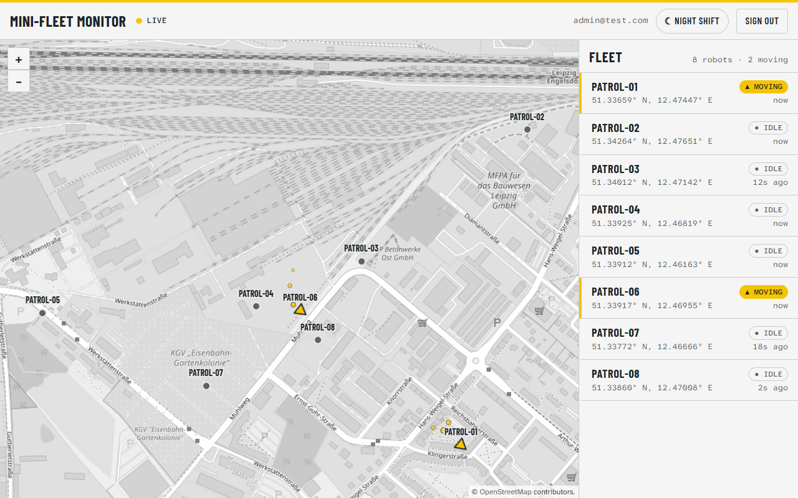
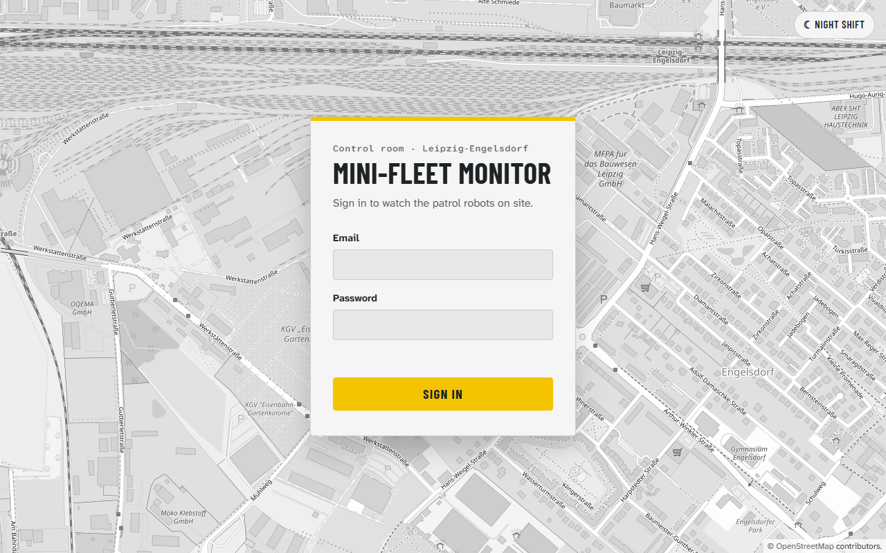
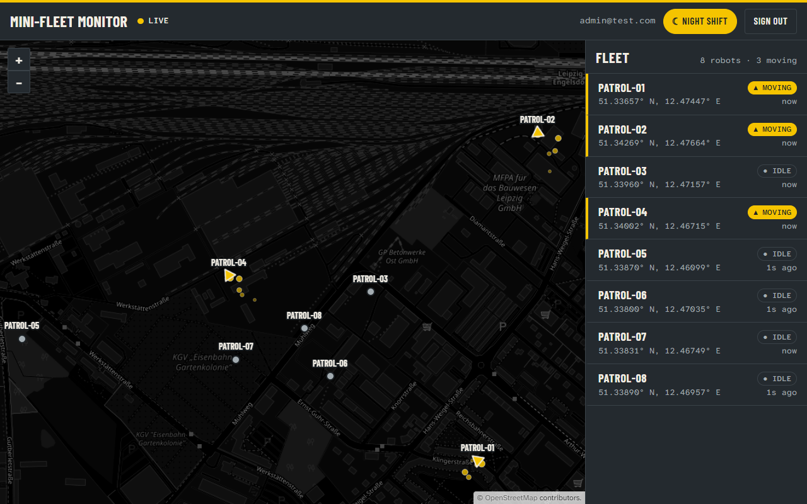

# Mini-Fleet Monitor

**English** · [Deutsch](README.de.md)

A small full-stack web application that monitors a fleet of virtual patrol robots: a simulation
moves them every two seconds, the positions are stored in PostgreSQL, published through Redis and
pushed to the browser over a WebSocket, where they appear live on an OpenLayers map.



## Quick start

Requirements: Docker with Docker Compose.

```bash
docker compose up --build
```

Then open **http://localhost:8080** and sign in with **`admin@test.com` / `test123`**.

| Service | URL / port | Notes |
|---|---|---|
| Web (React, nginx) | http://localhost:8080 | the application |
| API (Express, WebSocket) | http://localhost:4000 | REST + `ws://localhost:4000/ws` |
| PostgreSQL | `localhost:5433` | user / password / database: `fleet` |
| Redis | `localhost:6379` | Pub/Sub for live updates |

All ports are bound to `127.0.0.1`. The database schema and the demo data (one user, eight robots)
are created automatically on the first start. `docker compose down -v` resets everything.

`JWT_SECRET` falls back to a clearly labelled **demo-only** value so the stack starts from a clean
checkout. Set your own in a `.env` file (see [`.env.example`](.env.example)) for anything beyond a
local demo.

### Local development without Docker for API and web

```bash
docker compose up -d db redis     # only the databases
cp .env.example .env              # set JWT_SECRET to a random string of 32+ characters

# terminal 1 — API on http://localhost:4000, reloads on change
cd api && npm install && npm run dev

# terminal 2 — web on http://localhost:5173
cd web && cp .env.example .env && npm install && npm run dev
```

The API in Docker and the local API both use port 4000, so run one of them at a time
(`docker compose stop api web`).

## Architecture

A simulation timer in the API moves about half of the robots every two seconds through the same
service function that backs `POST /robots/:id/move`; robots that did not move become `idle`. Each
move is one atomic SQL statement that updates the robot and appends to its position history, after
which the service publishes a `robot.updated` event to Redis Pub/Sub. A dedicated Redis subscriber
in the API forwards every event to all authenticated WebSocket clients, so several API instances
could share one channel. The React frontend loads a snapshot with `GET /robots`, applies live
events on top (newer `updated_at` wins), and moves the OpenLayers features in place with a short
animation instead of rebuilding the layer.

```
 Simulation (every 2 s) ─┐
 POST /robots/:id/move ──┴─▶ robotService ──▶ PostgreSQL (robots, robot_positions)
                                   │
                                   └─▶ Redis PUBLISH robots:updates
                                              │
                          Redis subscriber ◀──┘
                                   │
                          WebSocket /ws ──▶ React: roster + OpenLayers map
                                                ▲
                          GET /robots (JWT) ────┘  initial snapshot and resync
```

## Screenshots

| Login | Dashboard, night shift |
|---|---|
|  |  |

Moving robots are yellow arrows pointing along their heading with a fading trail; idle robots are
steel circles. The roster shows the same state as text: call sign, status, last position and age.

## API

| Method | Path | Auth | Description |
|---|---|---|---|
| `POST` | `/auth/login` | — | `{ email, password }` → `{ token, user }` (JWT, 1 h) |
| `GET` | `/robots` | Bearer | all robots |
| `POST` | `/robots/:id/move` | Bearer | moves the robot 10–50 m in a random direction |
| `GET` | `/health` | — | 200 when PostgreSQL and Redis answer, otherwise 503 |
| `WS` | `/ws?token=<jwt>` | JWT in query string | pushes `{"type":"robot.updated","robot":{…}}` |

The browser WebSocket API cannot send an `Authorization` header, so the token travels in the query
string and is verified during the HTTP upgrade (invalid token → `401` before the socket opens).

## Stack

- **API:** Node.js 24, Express 5, `pg` (plain SQL, no ORM), `redis`, `ws`, `jsonwebtoken`, `bcryptjs`
- **Web:** React 19 (JavaScript), Vite, React Router, OpenLayers, plain CSS
- **Infrastructure:** PostgreSQL 16, Redis 7, Docker Compose, nginx

## Design decisions and trade-offs

- **JavaScript, not TypeScript** — the brief asks for "React (JS)"; the API follows for one language.
- **Atomic moves.** The move is a single data-modifying CTE (`UPDATE … RETURNING` + `INSERT` into
  the history), so concurrent moves of the same robot never lose an update.
- **Redis Pub/Sub instead of an in-memory broadcast** — events reach clients of every API instance.
- **Ordering.** Events and snapshots are merged by `updated_at`; an older message never overwrites a
  newer position.
- **Resilience.** The API fails fast at startup without PostgreSQL or Redis, reconnects to Redis at
  runtime, keeps simulating while Redis is down, and shuts down gracefully on `SIGTERM`. The web app
  reconnects with backoff and resyncs with `GET /robots` after every reconnect.
- **Security.** Parameterised SQL, bcrypt with a timing-safe login path (unknown email and wrong
  password take the same time), JWT pinned to HS256, the same token check for REST and WebSocket.
- **Fonts are self-hosted** (SIL OFL, licences in `web/public/fonts`) — no visitor IP is sent to
  Google (GDPR).
- **Accessibility.** Status is shown by shape, colour and text; the map is keyboard-operable;
  `prefers-reduced-motion` disables the marker animation.
- **Token in `localStorage`** (allowed by the brief). It is readable by any script on the page; a
  production setup would use an httpOnly cookie.
- **Demo defaults.** The Postgres password `fleet` and the default `JWT_SECRET` are for local demos
  only.

## How this was built

I used Claude Code as a pair programmer; the team left the use of AI tools up to me. The workflow:

- The brief was split into numbered requirements ([REQUIREMENTS.md](REQUIREMENTS.md)) and small
  steps, each finished, verified and committed on its own.
- Before every commit two review agents ran: one for lint, build, Docker and smoke tests, one for a
  review of the diff (bugs, security, requirement gaps). Frontend changes were also checked against
  the Vercel Web Interface Guidelines.
- Each step was tested against real failures, not only the happy path: database and Redis outages,
  forged and expired tokens, concurrent moves of one robot, a cold start with the page open and the API down, and the
  browser with keyboard and `prefers-reduced-motion`.

This caught real defects before they were committed, for example a malformed WebSocket upgrade
request that could crash the API before any authentication, and Docker restarting the API forever when
`.env.example` was copied unchanged. I can walk through and explain every part of the code.

## Requirements coverage

| Requirement | Status |
|---|---|
| Node.js + Express, PostgreSQL, Redis (Pub/Sub), JWT, CORS, REST + WebSocket, Docker Compose | ✅ |
| Redis as a cache for `GET /robots` (TTL 10 s) | not yet |
| React (JS), OpenLayers map, login page, protected dashboard, live markers | ✅ |
| Data model `users`, `robots` (`idle` / `moving`) | ✅ |
| `POST /auth/login`, `GET /robots`, `POST /robots/:id/move` (also run automatically) | ✅ |
| Simulation every 2 s: database update + broadcast | ✅ |
| Roster next to the map (name, status, last position) | ✅ |
| `docker compose up` starts api, db, redis and the frontend; demo user `admin@test.com` | ✅ |
| Bonus: Redis Pub/Sub instead of in-memory broadcast | ✅ |
| Bonus: position history (`robot_positions`) | ✅ |
| Bonus: deployable with Dockerfile + docker-compose | ✅ |
| Bonus: Start/Stop simulation buttons | not yet |
| Optional: `POST /robots` | not yet |
